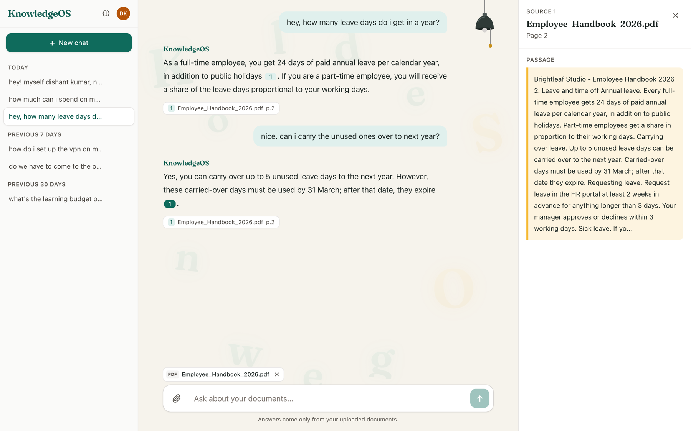
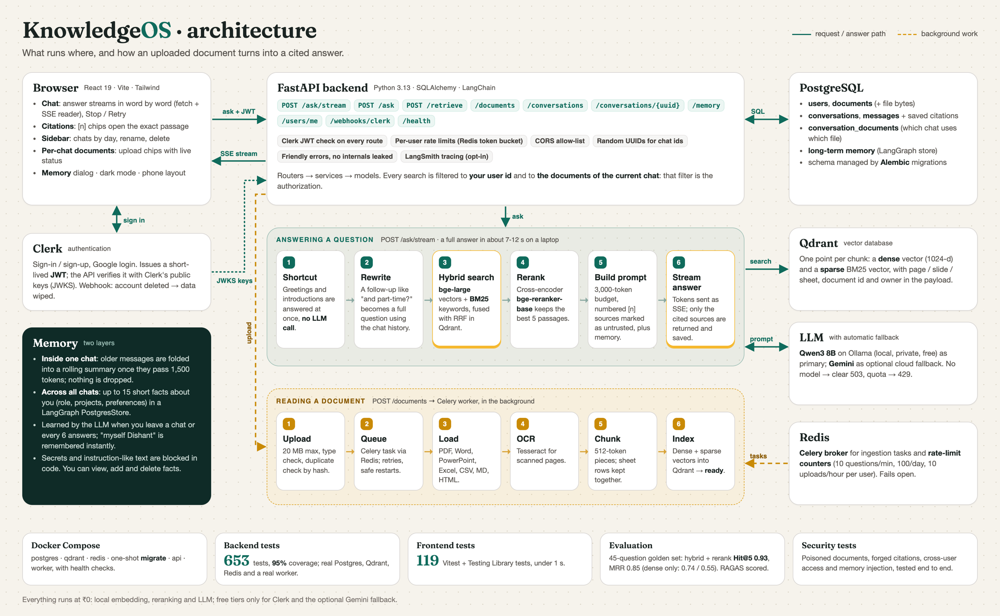
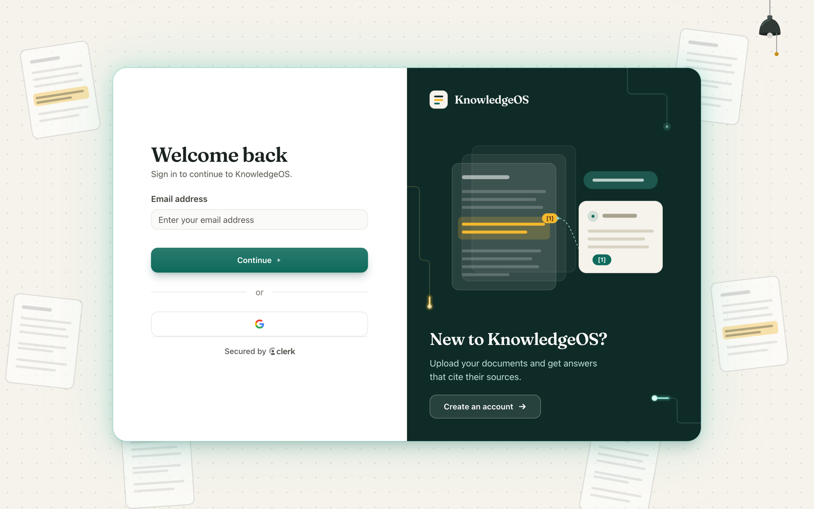
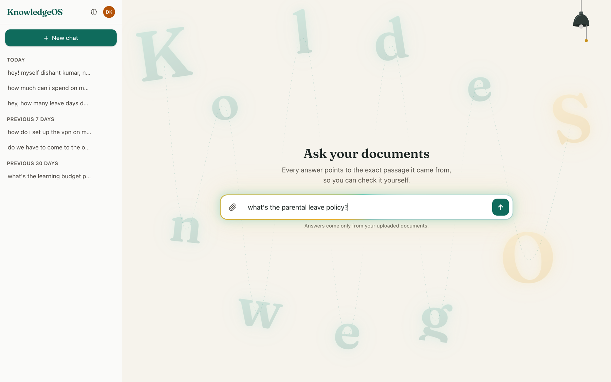
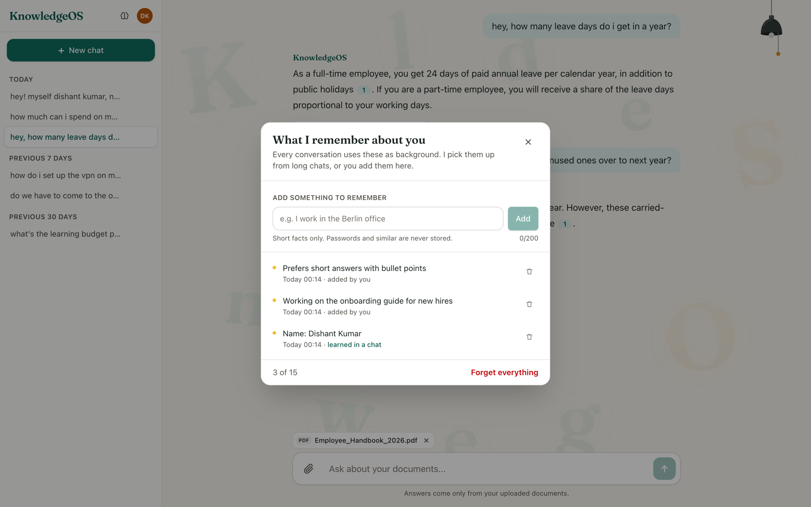
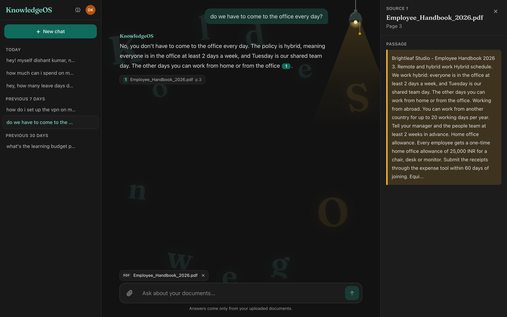
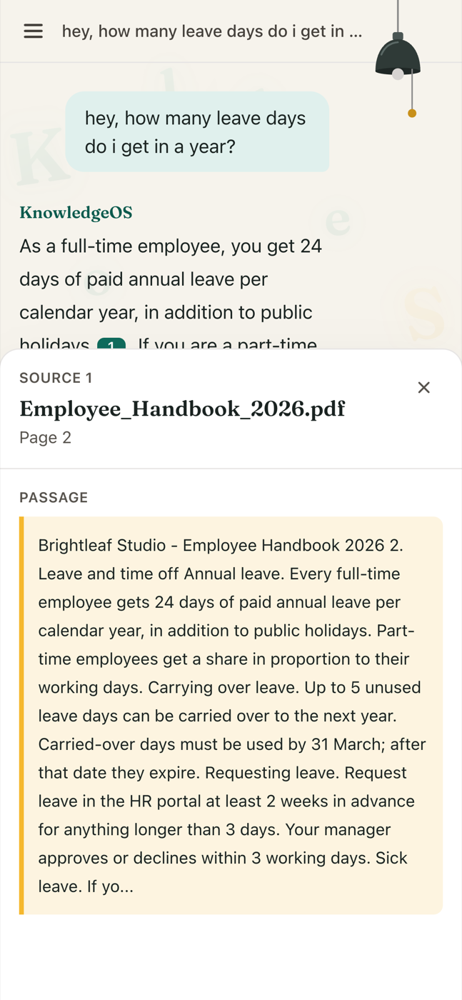

# KnowledgeOS

**Chat with your own documents and get answers you can check.** Every answer points to the exact passage it came from.

Upload PDFs, Word, PowerPoint, Excel, CSV, Markdown or HTML files into a chat and ask questions in plain language. KnowledgeOS finds the right passages with hybrid search, reranks them, and streams back an answer with numbered citations. Click one and you see the source text. It runs entirely on free, local models, so it costs ₹0.




<!-- Demo GIF: record a 20-30 s clip (upload -> ask -> click a citation) and put it here as docs/demo.gif -->

---

## Contents

- [What it does](#what-it-does)
- [Architecture](#architecture)
- [How the RAG pipeline works](#how-the-rag-pipeline-works)
- [Engineering decisions](#engineering-decisions)
- [Screenshots](#screenshots)
- [Results](#results)
- [Security](#security)
- [Tech stack](#tech-stack)
- [Running it locally](#running-it-locally)
- [Project structure](#project-structure)

## What it does

- **Answers with sources.** Each claim carries a `[n]` chip. It opens the passage, the file name and the page, slide or spreadsheet rows. If the documents don't contain the answer, it says so instead of guessing.
- **Documents belong to a chat.** Files you add to a conversation are the only ones its questions search, so two projects never mix.
- **Streaming.** The answer appears word by word, and you can stop it at any time.
- **Remembers you.** Short facts about you, like your role, projects and preferences, carry across all your chats. Long chats are summarised so nothing is lost. You can see, add and delete every fact.
- **Everyday polish.** Chats are grouped by day and can be renamed or deleted. Uploads show live status. Greetings get instant answers. It has dark mode and a phone layout.
- **Free to run.** Embeddings, reranking and the LLM (Qwen3 8B through Ollama) all run locally. Gemini is an optional cloud fallback.

## Architecture



**Memory** has two layers:

- **Short-term memory (one chat).** This is what the assistant remembers inside the current conversation.
  - Recent messages are sent to the model as they are.
  - Once the messages that aren't summarised yet pass **1,500 tokens**, the LLM folds the older ones into a **rolling summary**, stored on the conversation in Postgres.
  - Each prompt gets the summary plus the newest ~800 tokens of messages.
  - Nothing is ever deleted, so a long chat keeps its context without overflowing the prompt.
- **Long-term memory (all chats).** This is what the assistant remembers about *you* across every conversation.
  - Up to **15 short facts**, such as your name, role, ongoing projects and preferences, stored in a LangGraph `PostgresStore`.
  - The LLM picks out durable facts when you leave a chat, or after every 6 answers. Introductions like "myself Dishant" are saved instantly by a rule-based parser.
  - Secrets and instruction-like text are refused.
  - You can view, add and delete facts in the "What I remember about you" dialog.

## How the RAG pipeline works

**RAG (retrieval-augmented generation)** means the model doesn't answer from what it memorised during training. For every question it is handed the most relevant passages from *your* documents and told to answer only from them. KnowledgeOS does this in four stages. The first runs once per document; the other three run on every question.

```
 INGESTION            RETRIEVAL                 AUGMENTATION            GENERATION
 (once per file)      (every question)          (every question)        (every question)
 file -> chunks ->    question -> rewrite ->    best 5 passages ->      prompt -> LLM ->
 vectors in Qdrant    hybrid search -> rerank   numbered prompt         streamed, cited answer
```

### 1. Ingestion: turning a file into searchable pieces

**Definition:** ingestion reads a document, cleans it, cuts it into small overlapping pieces (*chunks*) and stores each chunk as numbers (*embeddings*) that capture its meaning, so it can be found later. It runs in the background on a Celery worker, so the upload returns immediately.

1. **Upload** (`POST /documents`): the API checks the file type and the 20 MB limit, computes a hash to detect a file you already uploaded, stores the bytes in Postgres, links the file to the current chat, and queues a task through Redis. Status: `pending`.
2. **Load** (`ingestion/loaders/`): a loader picked by file type extracts the text and remembers where it came from: PDF pages (PyMuPDF), Word, PowerPoint slides, Excel and CSV rows, Markdown and HTML. Status: `processing`.
3. **OCR** (`ingestion/ocr/`): a page with almost no text (fewer than 20 characters) is probably a scan. It is rendered at 300 DPI and read with Tesseract, and retried with different image settings if Tesseract's confidence is below 60%.
4. **Clean** (`ingestion/cleaning/`): strips control characters, normalises Unicode and whitespace, rejoins words hyphenated across lines, removes headers and footers repeated on many pages, removes duplicate lines, and drops empty pages.
5. **Chunk** (`ingestion/chunking/`): text is split into chunks of at most **512 tokens with a 64-token overlap**, so a sentence cut at a boundary still appears whole in one chunk. Slides stay whole up to 1,024 tokens, spreadsheets are grouped 20 rows at a time (never across two sheets), and HTML is split at its headings. Each chunk keeps its file name, page, slide or rows.
6. **Embed** (`ingestion/embedding/`): each chunk gets two vectors. A **dense vector** (1,024 numbers from `bge-large-en-v1.5`) captures meaning, so "vacation" finds "annual leave". A **sparse BM25 vector** captures exact words, so a policy code or a number still matches.
7. **Index**: both vectors and the chunk's metadata (owner, document id, location) are saved as one point in **Qdrant**. Status: `ready`, and the chip in the chat turns into a plain file chip.

### 2. Retrieval: finding the passages that answer the question

**Definition:** retrieval searches all chunks of the chat's documents and returns the few that most likely contain the answer. Good retrieval matters most in RAG: the model can't use a passage it never receives.

0. **Shortcut**: greetings and introductions ("hi, myself Dishant") are recognised by rules and answered at once, without searching or calling the model. A chat with no documents gets a short "add a document first" reply.
1. **Rewrite**: a follow-up like "and can I carry them over?" means nothing on its own. The LLM rewrites it into a standalone question using the chat history (and the chat summary): "Can unused leave days be carried over to next year?"
2. **Hybrid search**: the question is embedded the same two ways. Qdrant runs the dense search and the BM25 search (15 results each) and fuses the two rankings with **reciprocal rank fusion (RRF)**, which rewards chunks that rank well in both lists. The search is filtered to **your user id and this chat's documents**, so nobody else's files can ever come back. The best 30 candidates move on.
3. **Rerank**: a **cross-encoder** (`bge-reranker-base`) reads the question and each candidate *together* and scores how well the passage answers it. This is slower than vector search but much more precise, so it only runs on the 30 candidates and keeps the **top 5**.

### 3. Augmentation: building the prompt

**Definition:** augmentation adds the retrieved passages, and any useful context, to the question to form the prompt the model will read. It decides what the model is allowed to know for this answer.

1. **Fit the budget** (`augmentation/context_builder.py`): the top passages are added in rank order until the **3,000-token** context budget is full; anything that doesn't fit is left out, and only the passages that really made it in are reported as used.
2. **Number the sources**: each passage is labelled `[1]`, `[2]`... with its file name and location, and the code remembers which number belongs to which chunk.
3. **Guard against injected instructions**: the prompt says the document text is untrusted data, not instructions, and the passages sit inside a separate context block, never in the user's message.
4. **Add context**: the chat's rolling summary, the newest messages, and the facts in your long-term memory (as background only, capped at 500 tokens). Earlier refusals are left out, so one "I don't know" can't make every later answer refuse.
5. **Rules**: answer only from the context, cite every claim with its number, and say plainly when the documents don't contain the answer. If no passage was found at all, the model isn't called; the standard "I couldn't find that" reply is returned instead.

### 4. Generation: writing the answer

**Definition:** generation sends the prompt to the language model and turns its output into the final, cited answer the user sees.

1. **Call the model** (`generation/llm.py`): **Qwen3 8B** through Ollama runs locally and is the default. If it fails, LangChain's `with_fallbacks` switches to **Gemini**, if one is configured. No model available: a clear `503`; a used-up quota: `429`.
2. **Stream** (`generation/orchestrator.py`): tokens are sent to the browser as **server-sent events** while they are generated, so the answer appears word by word, and the Stop button can cancel it.
3. **Check the answer**: a refusal is recognised even when the model words it differently, and a blank answer becomes the standard refusal.
4. **Map citations** (`augmentation/citation_mapper.py`): the `[n]` numbers in the answer are matched back to the real chunks. Only the sources the answer actually cites are returned, each with its file, page, slide or rows and a 600-character passage. The model can't cite a source it wasn't given.
5. **Save and remember**: the question, the answer and its citations are saved in Postgres, and a final `done` event is sent. Afterwards, out of the user's way, long chats get their rolling summary updated and durable facts about you are merged into long-term memory.

## Engineering decisions

Each one was measured or argued, not assumed:

- **Hybrid search instead of vectors alone.** Dense embeddings miss exact terms such as policy names, codes and numbers, and BM25 catches them. Fusion happens inside Qdrant (RRF), so it's still one query.
- **Removed parent/child chunking.** It looked good on paper, but the expanded parent chunks overflowed the 3,000-token prompt budget: 41 of 45 questions lost passages before the LLM saw them. Plain 512-token chunks did better.
- **Query paraphrasing is off by default.** Generating 4 paraphrases per question cost about 6 s (retrieval went from 8.4 s to 2.3 s without them) with no gain in Hit@5 (0.93 vs 0.93). The history-aware rewrite stays, because follow-up questions need it.
- **Streaming over `fetch`, not `EventSource`.** `EventSource` can only send GET and can't add an `Authorization` header, and axios can't stream in the browser. The stream is read with a `ReadableStream` reader, and HTTP errors before the first token are still real status codes.
- **Authorization lives in the search filter.** Every Qdrant query is filtered by the caller's user id and the chat's document ids. A test proves that a poisoned memory claiming "user is admin" can't widen it.
- **Citations are assigned by code, not by the model.** The model only sees `[1]..[n]`. Numbers are mapped back to real sources afterwards, so it can't invent a source that wasn't retrieved.
- **Leftover refusals are kept out of the prompt.** A real bug, found with local Qwen: one early "I don't know" in the history made every later answer refuse (3/3). Refused and canned turns are now left out of the model's history (3/3 answered).
- **Token-bucket rate limits in Redis.** 10 questions per minute and 10 uploads per hour use a token bucket. A fixed-window counter caps questions at 100 per day. Each check is an atomic Lua script, and the limiter fails open if Redis is down.
- **Random UUIDs in URLs.** Conversations are addressed by a random UUID, never by the internal integer id, so ids can't be guessed or counted.
- **Local-first LLM with a fallback.** Ollama (Qwen3 8B) is the primary model. LangChain's `with_fallbacks` switches to Gemini on errors. No model available gives a clear 503; an exhausted quota gives 429.

## Screenshots

| Sign in | Start a chat |
|---|---|
|  |  |
| **What it remembers about you** | **Dark mode** |
|  |  |

<p align="center"><br><em>On a phone the source opens as a bottom sheet.</em></p>

## Results

### Retrieval and answer quality

Measured with the evaluation harness in [`backend/eval/`](backend/eval/README.md): 13 synthetic documents, 121 chunks and a 45-question golden set (42 answerable, 3 out of scope). Local Qwen3 8B is both generator and judge.

| Metric | Dense only | Hybrid | **Hybrid + rerank** (used) |
|---|---|---|---|
| Hit@5: all needed passages found | 0.74 | 0.93 | **0.93** |
| MRR: right passage near the top | 0.55 | 0.78 | **0.85** |
| Answers correct | 0.74 | 0.93 | **0.93** |
| False refusals | 0.24 | 0.07 | **0.05** |
| Cites an expected document | 0.74 | 0.90 | **0.93** |
| Refuses out-of-scope questions | 1.00 | 1.00 | **1.00** |
| RAGAS faithfulness | 0.80 | 0.75 | **0.82** |
| RAGAS context precision | 0.52 | 0.69 | **0.74** |

Adding BM25 to dense search fixes most misses: answers correct go from 0.74 to 0.93. Reranking then puts the right passage first more often (MRR 0.78 to 0.85) and lowers false refusals. RAGAS scores come from a small local judge on a 20-question sample, so they're useful for comparing columns, not as absolute numbers.

### Tests

| | Tests | What they cover |
|---|---|---|
| **Backend** (pytest) | **653 passing, 95% line coverage** | Mostly integration tests against **real** Postgres, Qdrant and Redis, the real embedding and reranking models, and a real Celery worker end to end. The LLM is faked for determinism, and a smaller set runs against real local Qwen. Includes auth, rate limits, ingestion of every file type, retrieval, citations, memory and prompt injection. |
| **Frontend** (Vitest + Testing Library) | **119 passing, under 1 s** | Error mapping, the SSE stream parser (split chunks, cut-off streams, abort), components, upload and conversation hooks (with fake timers), and an integration test of the whole chat screen. The API and Clerk are mocked. |

## Security

What the pipeline guarantees, proven by deterministic tests that assume a **fully compromised model**:

- Text in a document (including hidden HTML text, CSV cells and PDF text) only ever lands inside the prompt's context block, after a guard sentence. It never lands in the user's message.
- Citation markers written inside a document can't change the code-assigned markers, and the model can't cite sources that weren't retrieved.
- File names never enter the prompt.
- One user's documents never reach another user, whether through the prompt, citations or `/retrieve`.
- Secrets and instruction-like text are refused as memory facts.
- The frontend renders answers and snippets as plain text, never as HTML or markdown.
- Clerk JWTs are verified on every route. The only anonymous routes are `/health` and the signed Clerk webhook. CORS uses an allow-list. Raw error text from failed documents is never returned to the client.

Known gaps, documented as strict `xfail` tests so a fix shows up immediately:
1. Model output isn't filtered: a markdown image link to an attacker's server would pass through the API. The bundled frontend is safe because it never renders markdown.
2. The context block has no tamper-proof delimiter.
3. The memory guard is a keyword filter, not a classifier.

## Tech stack

| Layer | Technology |
|---|---|
| Frontend | React 19, Vite 8, Tailwind CSS v4, React Router 7, axios, Clerk React; Vitest and Testing Library |
| API | FastAPI, Pydantic, SQLAlchemy 2, Alembic |
| Background work | Celery with a Redis broker |
| Search | Qdrant (dense and sparse vectors, RRF fusion); FastEmbed with `BAAI/bge-large-en-v1.5`, BM25 and `BAAI/bge-reranker-base` |
| Document parsing | LangChain loaders, PyMuPDF, Unstructured, Tesseract OCR |
| LLM | Qwen3 8B through Ollama (local), Google Gemini (optional fallback), LangChain |
| Memory | Postgres (conversation summaries), LangGraph `PostgresStore` (long-term facts) |
| Auth | Clerk (JWT verified with JWKS, svix-signed webhooks) |
| Quality | pytest (653 tests), RAGAS evaluation harness, LangSmith tracing (opt-in) |
| Infrastructure | Docker Compose (Postgres, Qdrant, Redis, migrations, API, worker, health checks) |

## Running it locally

The backend runs entirely in Docker: one command starts Postgres, Qdrant, Redis, the database migrations, the API and the worker. The frontend runs with npm, and the LLM runs in Ollama on your machine.

**You need:**
- [Docker Desktop](https://www.docker.com/products/docker-desktop/), running
- [Node.js](https://nodejs.org) 18 or newer
- [Ollama](https://ollama.com), with the model downloaded: `ollama pull qwen3:8b`
- A free [Clerk](https://clerk.com) application: in its dashboard, allow `http://localhost:5173`

### 1. Configure

```bash
git clone https://github.com/Dishant334/KnowledgeOS.git
cd KnowledgeOS
cp backend/.env.example backend/.env
cp frontend/.env.example frontend/.env
```

- **`backend/.env`:** fill in `CLERK_JWKS_URL` and `CLERK_ISSUER` (Clerk dashboard → API keys). Set `OLLAMA_BASE_URL=http://host.docker.internal:11434` so the containers can reach Ollama on your machine. Database, Qdrant and Redis addresses are set by Docker Compose, so you don't need to change them. Every variable is explained in the file.
- **`frontend/.env`:** set `VITE_CLERK_PUBLISHABLE_KEY` to your Clerk **publishable** key (`pk_...`, never the `sk_` secret). `VITE_API_URL` already points to `http://localhost:8000`.

### 2. Start the backend

```bash
cd backend
docker compose up -d --build
```

The first build takes a few minutes. Compose starts these services:

| Service | What it does | Port |
|---|---|---|
| `postgres` | users, documents, chats, messages, memory | 5433 |
| `qdrant` | vector search | 6333 |
| `redis` | task queue and rate limits | 6379 |
| `migrate` | applies the database migrations, then exits | |
| `api` | FastAPI backend | 8000 |
| `worker` | Celery worker that reads uploaded documents | |

Check that everything is up:

```bash
docker compose ps                    # api and worker should show "healthy" after about a minute
curl http://localhost:8000/health    # {"status":"ok"}
```

### 3. Start the frontend

```bash
cd ../frontend
npm install
npm run dev
```

Open **http://localhost:5173**, create an account, add a document with the paperclip and ask a question. The first question after a start downloads and loads about 3 GB of search models, so it takes a minute; they are cached in a Docker volume after that.

### Everyday commands

Run these in `backend/`:

| Command | What it does |
|---|---|
| `docker compose logs -f api worker` | follow the API and worker logs |
| `docker compose up -d --build` | rebuild and restart after changing backend code |
| `docker compose stop` | stop everything; data is kept |
| `docker compose down` | stop and remove the containers; data is kept |
| `docker compose down -v` | remove everything **including all data** (documents, chats, memory) |

<details>
<summary><b>Developing the backend without containers</b> (hot reload and tests)</summary>

Keep only the databases in Docker and run the API and worker from a Python 3.13 virtual environment. On macOS you also need `brew install tesseract libmagic`.

```bash
python3.13 -m venv .venv
.venv/bin/pip install -r backend/requirements.txt -r backend/requirements-dev.txt
cd backend
docker compose up -d postgres qdrant redis
../.venv/bin/alembic upgrade head
../.venv/bin/uvicorn app.main:app --reload                              # API on :8000
../.venv/bin/celery -A app.worker.celery_app worker --loglevel=info     # second terminal
```

In this mode, use the local addresses in `backend/.env` (Postgres on `localhost:5433`, and `OLLAMA_BASE_URL=http://localhost:11434`).

Tests and evaluation:

```bash
cd backend && ../.venv/bin/python -m pytest -q    # isolated <db>_test database, Redis DB 15, its own Qdrant collection
cd frontend && npm test                           # Vitest
cd backend && ../.venv/bin/python -m eval.run     # full evaluation (about an hour with local models), see backend/eval/README.md
```

</details>

## Project structure

```
backend/
  app/
    routers/        HTTP routes (ask, documents, conversations, memory, users, webhooks)
    services/       business logic (ask flow, uploads, conversations, social messages, memory steps)
    ingestion/      loaders -> OCR -> cleaning -> chunking -> embeddings -> Qdrant
    retrieval/      query rewrite, hybrid search, reranking
    augmentation/   context builder and prompt
    generation/     LLM factory with fallback, streaming, citations, summaries
    memory/         long-term memory store and consolidation
    core/           settings, Clerk auth, rate limits, CORS, tracing
    db/models/      SQLAlchemy models        worker/  Celery app and tasks
  alembic/          migrations
  tests/            653 tests (integration-first)
  eval/             golden set, metrics, RAGAS scoring, reports
frontend/
  src/
    api/            axios client, SSE stream reader, error mapping
    features/       chat, documents, memory (components, hooks, tests next to them)
    auth/ theme/ components/ layout/ pages/ lib/
docs/               architecture diagram and screenshots
```
